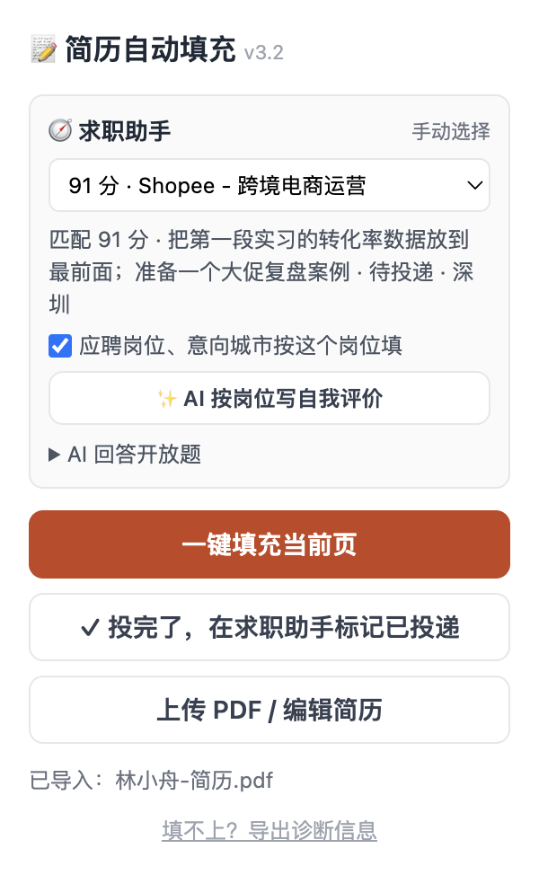
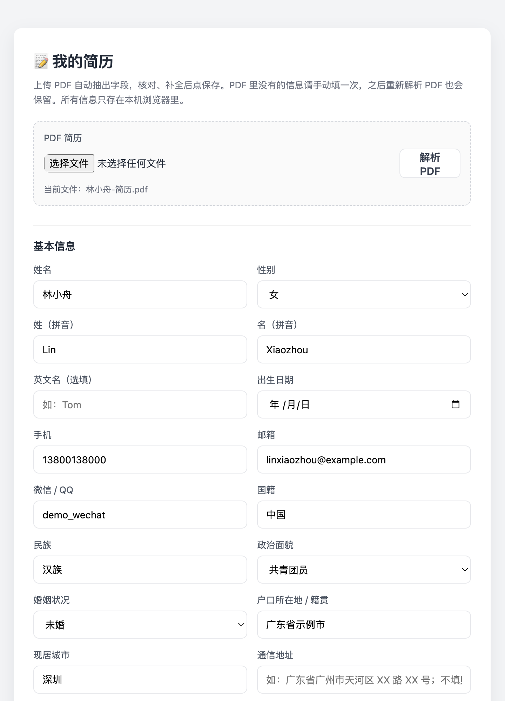

# 📝 简历自动填充

Chrome / Edge 扩展：上传 PDF 简历自动解析成结构化字段，在各家网申页一键填表，包括教育、实习、项目这些要反复点「添加」的区块，以及省市联动下拉、学校搜索框、日期面板这类自定义组件。

| 弹窗：关联岗位、AI 文书、一键填充 | 选项页：PDF 解析结果，核对后保存 |
| --- | --- |
|  |  |

> 截图里的简历是虚构的（林小舟、示例大学、example.com 邮箱）。

同一套求职工作流里的另外两个项目：

- [job-hunter](https://github.com/oxygenxx77/job-hunter)：求职助手，采集岗位 + AI 匹配 + 辅助投递
- [qiuzhao-kanban](https://github.com/oxygenxx77/qiuzhao-kanban)：秋招看板，管投递之后的测评、面试、Offer

## 功能

- **PDF 解析**：用 pdf.js 在本地抽出文字，按版块识别基本信息、教育、实习、项目、校园经历、获奖、语言、证书、技能、自我评价；PDF 里没有的信息手动补一次，之后重新解析也会保留
- **一键填充**：按标签文字匹配字段（「手机号码」「联系电话」「mobile」都对应手机），同一控件取最长命中的关键词，避免「学校所在地」被当成学校名
- **可重复区块**：实习 / 项目 / 教育等经历不够时，自动找到「添加」按钮点开新的一条再填
- **自定义组件**：
  - 受控输入框：走原生 value setter，React / Vue 才能感知到变化
  - 下拉：先展开，按「完全一致 > 前缀 > 包含」打分选项；可搜索的下拉（学校名）先打字再选，搜不到时用「使用 XX 作为我的学校」
  - 省市区联动：「广东广州」这种没写后缀的也能逐级选中，直辖市、钻错层级都有处理
  - 日期面板：切到年 / 月视图逐级点选
  - 以控件上实际显示的文字为准判断是否选上，而不是「点过就算」
- **诊断导出**：填不上时一键导出页面表单结构，方便针对新网站补规则
- **与求职助手联动**（求职助手在本机运行时出现）：识别当前网申页对应哪个岗位，按岗位填应聘岗位和意向城市；AI 按岗位 JD 写自我评价、回答开放题；投完后一键在求职助手标记已投递，同步到秋招看板；简历可同步到求职助手供 AI 匹配

## 安装

1. 打开 `chrome://extensions`（Edge 为 `edge://extensions`），打开「开发者模式」
2. 点「加载已解压的扩展程序」，选择本项目目录
3. 点扩展图标 →「上传 PDF / 编辑简历」，上传简历并核对字段

## 文件

```
resume-autofill/
├── manifest.json    # Manifest V3
├── parse.js         # PDF 文字 → 简历字段
├── content.js       # 注入网申页：识别表单、填写、处理各类组件
├── popup.html/js    # 弹窗
├── options.html/js  # 简历编辑页
├── jobhunter.js     # 与本机求职助手通信（127.0.0.1:8001）
└── lib/             # pdf.js
```

## 隐私

- 简历只存在浏览器本地（`chrome.storage.local`），扩展不向任何服务器上传数据
- 唯一的网络请求是本机的求职助手（`127.0.0.1`），且同步简历时不带手机号、邮箱、身份证号和住址

## 许可证

[MIT](LICENSE)。`lib/` 下的 [pdf.js](https://github.com/mozilla/pdf.js) 遵循它自己的 Apache-2.0 许可证。
